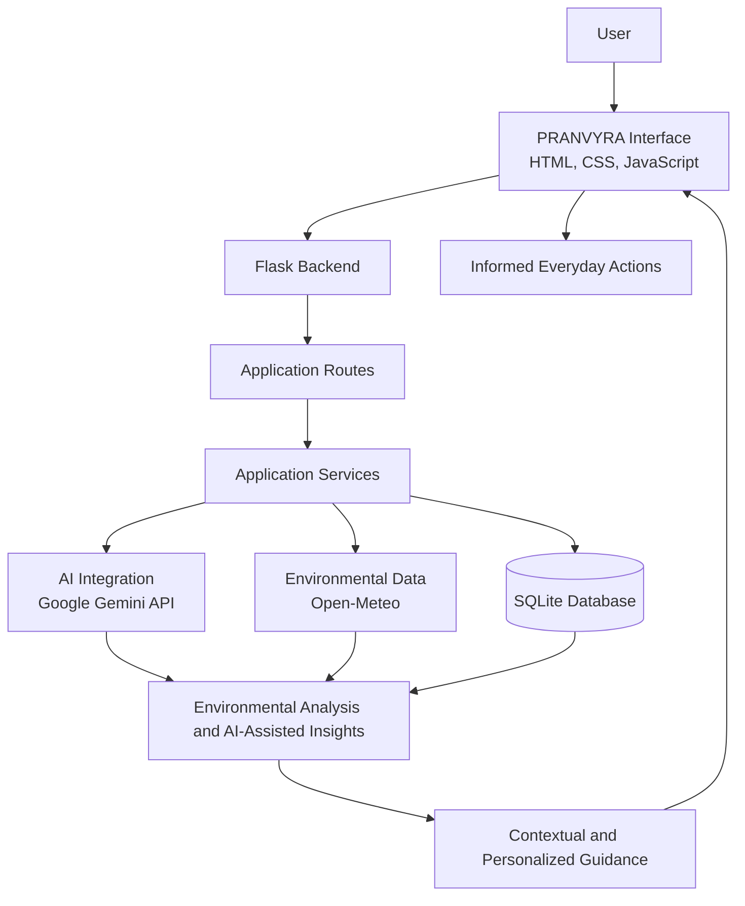

# PRANVYRA — Every Breath. A Better Tomorrow.

### Turning Environmental Intelligence into Everyday Action

PRANVYRA is an AI-driven hyperlocal environmental intelligence platform designed to help people understand environmental conditions, make informed daily decisions, and adopt more sustainable lifestyles.

Rather than simply displaying environmental measurements, PRANVYRA connects environmental data with AI-assisted insights, contextual recommendations, and practical everyday actions.

**Our approach:**

Environmental Data → AI-Assisted Analysis → Personalized Guidance → Informed Decisions → Sustainable Actions

---

## 🏆 Competition Submission

| Detail | Information |
|---|---|
| Competition | PromptWars — Hack2Skill |
| Project Name | PRANVYRA |
| Project Domain | AI, Environmental Intelligence & Sustainability |
| Repository | Public GitHub Repository |
| Demonstration Video | [INSERT YOUR VIDEO LINK] |
| Repository Access | Public |

## 🌍 1. The Problem

Air pollution affects everyday activities, including commuting, exercising, outdoor work, and indoor ventilation.

Although air-quality information is increasingly available, people often struggle to understand what environmental measurements mean and how they should respond.

People need answers to practical questions:

- Is the current air quality suitable for outdoor activities?
- How can I plan my day around environmental conditions?
- What precautions should I take indoors?
- Can I explore alternative commuting routes?
- What sustainable lifestyle changes can I adopt?

The problem is not simply the lack of environmental data. It is the gap between environmental awareness and practical decision-making.

## 💡 2. Our Solution

PRANVYRA transforms environmental information into understandable, contextual, and actionable intelligence.

It brings environmental data, AI-assisted guidance, and personalized recommendations together in one integrated application.

The platform aims to help users move beyond knowing environmental conditions toward understanding and responding to them.

## ✨ 3. Key Features

### 🌫️ Air Intelligence
- Hyperlocal air-quality information.
- Weather and atmospheric context.
- Environmental insights to support everyday decisions.

### 🤖 AI Companion
- Conversational environmental assistance.
- Specialized expert roles and intelligent expert routing.
- AI-generated explanations and recommendations.
- Voice interaction capabilities.
- English, Hindi, and Bengali language support.

### 📅 Daily Planner
Environment-aware suggestions to help users organize everyday activities and make more informed daily plans.

### 🏠 Indoor Air Intelligence
Indoor environmental guidance, ventilation recommendations, and practical precautions. Estimates are clearly distinguished from physical sensor measurements.

### 🗺️ BreathRoute
Explore commuting alternatives with environmental considerations and route-related insights.

### ♻️ Life-Switch
Discover sustainable alternatives to everyday habits and activities.

### 📊 Impact Tracker
Track sustainability-related actions and explore estimated environmental impact.

### 🏙️ Neighborhood Pulse
Explore neighborhood-level environmental awareness and community-oriented environmental insights.

### 🧬 Air-Twin Profile
A personalized environmental profile designed to support context-aware recommendations.

## 🚀 4. What Makes PRANVYRA Different?

PRANVYRA focuses on what people can do with environmental information.

| Conventional Environmental Information | PRANVYRA |
|---|---|
| Displays environmental measurements | Helps explain environmental conditions |
| Provides general information | Aims to offer contextual recommendations |
| Focuses on isolated data | Connects environmental information with daily routines |
| Encourages awareness | Supports informed everyday decisions |

**Our core idea:** Environmental intelligence should lead to meaningful action.

## 🧠 5. Technology Stack

| Component | Technology |
|---|---|
| Backend | Python, Flask |
| Frontend | HTML5, CSS3, Vanilla JavaScript |
| Database | SQLite |
| AI Integration | Google Gemini API |
| Air Quality & Weather | Open-Meteo |
| Maps | Leaflet, OpenStreetMap |
| Data Visualization | Chart.js |
| Testing | Pytest |

## 🏗️ 6. System Architecture

PRANVYRA follows a modular application architecture that connects the frontend, Flask backend, application services, external data providers, and database.



## 🌐 7. Multilingual Accessibility

PRANVYRA is designed to make environmental intelligence accessible to users beyond English-speaking audiences.

Supported languages:

- 🇬🇧 English
- 🇮🇳 Hindi
- 🇮🇳 Bengali

The multilingual interface aims to make environmental information and guidance easier to understand across different language backgrounds.

## ⚙️ 8. Installation and Setup

### Prerequisites

- Python 3.10 or later
- Git
- A modern web browser

### Step 1 — Clone the repository

```bash
git clone https://github.com/student-soumita/PRANVYRA.git
```

### Step 2 — Navigate to the project

```bash
cd PRANVYRA
```

### Step 3 — Create a virtual environment

```bash
python -m venv venv
```

Activate on Windows:

```powershell
venv\Scripts\activate
```

Activate on Linux/macOS:

```bash
source venv/bin/activate
```

### Step 4 — Install dependencies

```bash
pip install -r requirements.txt
```

### Step 5 — Configure environment variables

Create a `.env` file using `.env.example` as a reference, if provided in the repository.

Configure the required credentials:

```env
SECRET_KEY=your_secure_secret_key
GEMINI_API_KEY=your_gemini_api_key
```

Use your own secure credentials. Never commit real API keys, passwords, or secrets to GitHub.

### Step 6 — Run the application

```bash
python run.py
```

Open the application at:

`http://127.0.0.1:5000`

*Note: Follow the repository's actual configuration if the application uses a different entry point or environment setup.*

## 🧪 9. Testing

Run the available automated test suite:

```bash
pytest
```

The project includes automated tests intended to cover application routes, environmental services, recommendations, impact calculations, and translation dictionaries.

Actual test results should be verified by running the test suite in the current project environment.

## 🔐 10. Data Integrity and Limitations

- Environmental data availability depends on external providers and their geographic coverage.
- Hyperlocal estimates should not be interpreted as exact street-level measurements.
- Indoor Air Intelligence uses estimates where physical sensor readings are unavailable.
- Environmental impact calculations are estimates based on underlying assumptions.
- AI-generated recommendations are informational and are not a substitute for professional medical advice.
- PRANVYRA does not physically remove pollution or directly improve ambient air quality.

## 🔮 11. Future Scope

- Integration with physical air-quality sensors.
- Improved hyperlocal environmental modelling.
- Support for additional regional languages.
- More personalized environmental recommendations.
- Expanded community environmental intelligence.
- Enhanced accessibility and voice interaction.

## 🌱 12. Our Vision

We believe that understanding the environment is the first step toward making better decisions.

PRANVYRA aims to bridge the gap between environmental information and everyday action by making environmental intelligence understandable, accessible, and actionable.

**Every Breath. A Better Tomorrow.**

---

## 🔗 Project Links

- **GitHub Repository:** https://github.com/student-soumita/PRANVYRA
- **Live Application:** https://pranvyra.onrender.com/
- **Demo Video:** https://drive.google.com/file/d/12WVixwcctCek6WpIcf7MsIN3db77_UwQ/view?usp=sharing
- **Competition:** PromptWars — Hack2Skill
